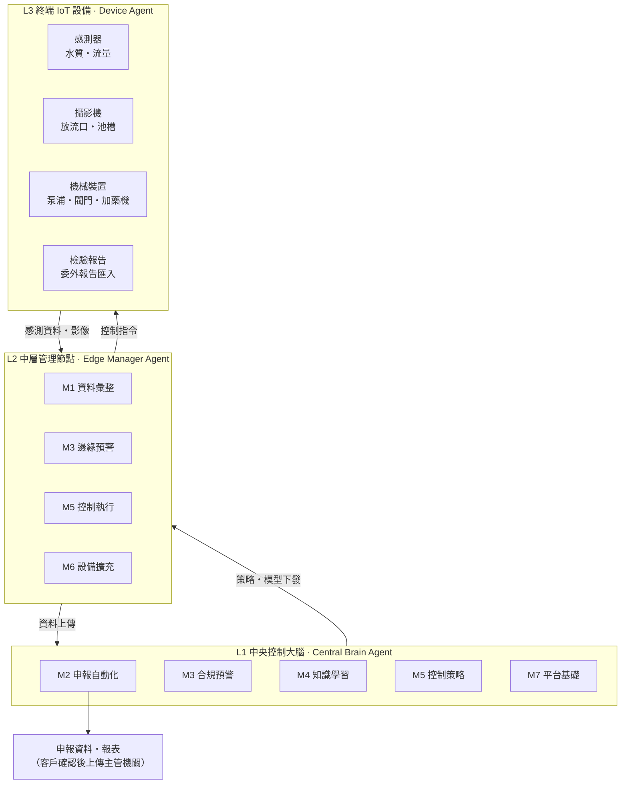
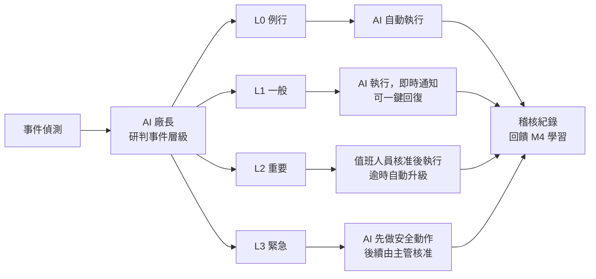

# WUCA — Water Unified Control Agents

**水務統一控制智能代理平台**：以 AI 與 IoT 感測技術打造的污水智能管理平台。

第一期聚焦半導體廠的**水污染防治費（水污費）自動化申報**，平台會：

- 定期自動收集各項計費指標
- 自動整理申報所需資料
- 從每日數據累積該廠的水質管理知識，再應用到自動化管理

## 文件

- [硬體清單](docs/hardware-list.md)：三層節點硬體規格、TEE 限制、終端 IoT 設備分類
- [單廠建置費用試算](docs/cost-estimate.md)：建置與維運費用、政府招標行情、建議招標預算

## 系統架構

WUCA 採三層多代理（multi-agent）架構：資料由終端往上匯集，申報與學習在中央進行，控制指令再往下執行。



| 層級 | 角色 | 職責 |
| --- | --- | --- |
| L1 中央控制大腦 | Central Brain Agent | 申報計算、全域決策、AI 模型訓練與下發、跨區調度 |
| L2 中層管理節點 | Edge Manager Agent | 管理轄區設備、資料彙整與品質檢核、邊緣推論、斷線時自主運作 |
| L3 終端 IoT 設備 | Device Agent | 感測器、攝影機、機械裝置的資料回報與指令執行 |

## 功能模組

M1、M2、M7 構成申報的最小可行組合，其餘模組可以逐步加購。

| 模組 | 主要功能 | 層級 | 導入方式 |
| --- | --- | --- | --- |
| M1 資料收集與設備接入 | 線上感測（pH、COD、濁度/SS、氨氮、氟離子、導電度、流量）；放流口與池槽影像；泵浦、閥門、加藥機狀態；委外檢驗報告匯入（PDF/OCR）；資料品質檢核 | L3 → L2 | 必備 |
| M2 水污費申報自動化 | 計費項目與費率參數庫（依法規版本切換）；實測值/係數雙模式計算；申報檔案自動產出（由廠方上傳）；查核值差異檢查；期程提醒；稽核軌跡 | L1 | 必備 |
| M3 合規監控與預警 | 對照放流水標準與許可限值；超標預警；水污費月度試算與減量優惠級距模擬 | L1、L2 | 可加購 |
| M4 水質知識學習 | 每日數據彙整；廠區知識庫（製程事件與水質變化的關聯）；濃度預測與異常偵測；自然語言問答 | L1 | 可加購 |
| M5 自動化管理與控制 | AI 廠長可操作所有終端設備，依事件層級授權；加藥量最佳化、泵浦調度；安全連鎖與手動接管 | L1 / L2 | 可加購（需 M4） |
| M6 設備擴充框架 | 設備註冊與 Device Profile；MQTT、Modbus、OPC UA；新終端開發 SDK；韌體更新 | L2、L3 | 平台內建 |
| M7 平台基礎 | 儀表板、帳號權限、通知、廠內地端部署、資安（OT/IT 區隔）、資料保存與備份 | L1 | 必備 |

## 法規依據

法源為《事業及污水下水道系統水污染防治費收費辦法》，環境部 2025-03-31 修正。

- **新增計費項目**：2026 年（民國 115 年）起新增氨氮、鋅、錫。
- **費率調整**：多項重金屬費率逐年調升到 2031 年（民國 120 年）。
- **費額計算**：

  ```
  費額 = Σ(費率ᵢ × 排放濃度ᵢ) × 排放水量
  ```

- **減量優惠**：依「排放濃度 ÷ 放流水標準最大限值」的級距打折，低於 10% 免繳，但仍須申報。
- **申報期程**：每半年一期，每年 1 月底、7 月底前經[水污費網路申報系統](https://wpcf.moenv.gov.tw)申報繳納。

| 計費項目（元/公斤） | 115 年 | 116 年 | 117 年 | 118 年 | 119 年 | 120 年 |
| --- | --- | --- | --- | --- | --- | --- |
| 化學需氧量（COD） | 12.5 | 12.5 | 12.5 | 12.5 | 12.5 | 12.5 |
| 懸浮固體（SS） | 0.62 | 0.62 | 0.62 | 0.62 | 0.62 | 0.62 |
| 氨氮（新增） | 40 | 50 | 60 | 65 | 75 | 80 |
| 鉛、鎳、銅 | 1,000 | 1,200 | 1,400 | 1,600 | 1,800 | 2,000 |
| 鋅、錫（新增） | 1,000 | 1,200 | 1,400 | 1,600 | 1,800 | 2,000 |
| 總鉻、砷 | 2,000 | 2,400 | 2,800 | 3,200 | 3,600 | 4,000 |
| 鎘、氰化物 | 10,000 | 12,000 | 14,000 | 16,000 | 18,000 | 20,000 |
| 總汞 | 50,000 | 60,000 | 70,000 | 80,000 | 90,000 | 100,000 |

**施行日期**：各年費率分別自民國 115–120 年的 **1 月 1 日**起施行（2026-01-01 至 2031-01-01），剛好落在半年申報期的開頭，每期只套用一組費率。分年費率本身就是「首年五折、五年遞減、第六年全額」的折後費率，**沒有另外的折扣**（[法規條文與附表](https://www.rootlaw.com.tw/LawArticle.aspx?LawID=A040300050004100-1140331)、[修正草案總說明](https://enews.moenv.gov.tw/DisplayFile.aspx?FileID=6C8C008C2453FF61)）。

**費額抵減**（第 16 條）：增設能資源化設施並維持操作 3 年以上者可申請，各期以該期費額 60% 為上限，最多抵減 3 年。

**法規參數自動更新**：費率、施行日、抵減規則、放流水標準與檢測頻率由中控大腦每日從政府公開資訊（環境部公告與預告、水污費申報系統、全國法規資料庫、行政院公報、園區管理局）比對更新；AI 產出參數變更草案，經管理者確認後依生效日版本化套用，舊版保留供稽核。

**計費依據**：排放濃度可用業別標準限值 90%、定期檢測申報最大值或連續自動監測數據；排放水量可用許可核准量 90%、定檢申報總水量或自動監測累加。申報值低於主管機關查核值 20%（COD、氨氮、SS、銅、鋅、總鉻）或 40%（鉛、鎳、總汞、鎘、砷、錫、氰化物）以上時，改以查核值計算；未檢出以方法偵測極限（MDL）計算。

**法定檢測頻率**（《水污染防治措施及檢測申報管理辦法》附表一）：晶圓及半導體製造業一般水質（pH、水溫、COD、SS、氨氮、總磷）每 3 或 6 個月一次；重金屬等特定水質多為每 6 個月一次；錫、六價鉻、硼、鉬每年一次。檢測頻率低、又可能以申報最大值計費，是平台推動連續自動監測計費的主要理由。

> 費率在平台中一律做成可依年度切換的參數，以[環境部公告](https://water.moenv.gov.tw/Public/CHT/wsr_1/WW_Control/WPCF.aspx)為準。

## 適用廠型

平台以「廠型設定檔」支援各類污水處理廠，計算與申報引擎共用。

| 廠型 | 申報數據對象 | 檢測申報期程 | 平台重點 |
| --- | --- | --- | --- |
| 自有放流口的事業 | 主管機關 | 1 月底、7 月底 | 水污費申報檔、減量優惠模擬 |
| 納管事業（排入科學園區下水道） | 下水道管理機關 | 依下水道管理機關規定 | 納管水質報告、納管限值預警 |
| 工業區／科學園區專用污水下水道系統 | 主管機關 | 2 月底、8 月底 | 納管戶水質管理、上游異常溯源 |
| 其他污水處理廠 | 依許可 | 依個廠許可 | 以設定檔套用 |

系統負責管理與優化水質、提交申報數據，不處理水污費由誰繳納或如何分攤。

**導入盤點**：每廠依許可證建立設定檔——放流口與排放去向、列管檢測項目與頻率（含免檢測項目）、核准每日廢水量、是否已設自動監測並連線主管機關（有則可用連續數據計費，平台只讀接入）、現有儀器與 SCADA、近三期申報資料。

申報方式：平台**產出申報檔案**，由廠方上傳環境部系統。部署方式：**廠內地端**。

## 事件分級與授權執行

AI Agent 擔任**廠長**，可操作所有終端設備；中央管理平台設定事件層級與各層級的授權流程（層級數、門檻與核准人可逐廠調整）。



| 層級 | 觸發例 | 授權流程 | 通知對象 |
| --- | --- | --- | --- |
| L0 例行 | 加藥量微調、泵浦輪替、儀器校正提醒 | AI 自動執行 | 日報彙整 |
| L1 一般 | 水質趨勢偏離、接近減量優惠級距邊界 | AI 執行後即時通知，可一鍵回復 | 值班人員 |
| L2 重要 | 預估將超標、設備切換、處理單元停機 | 值班人員核准後執行；逾時升級到主管 | 值班人員、廠務主管 |
| L3 緊急 | 已超標、洩漏、安全事件 | AI 先執行預授權安全動作（切回收槽、暫停放流、隔離），後續由主管核准 | 廠務主管、環安單位 |

**預設門檻**（濃度 ÷ 放流水標準或納管限值；依目前公開數據設計，由中控大腦定期更新，各廠可覆寫）：L0 低於 60%；L1 達 60% 或將跨減量優惠級距；L2 預測 24 小時內達 80%、單元停機或儀器故障逾 1 小時；L3 實測達 100%、洩漏或安全事件。

**管理模式模板**（各廠選一套後自訂層級、門檻、核准人、逾時與通知）：

| 層級 | 保守（導入期） | 標準（預設） | 自主 |
| --- | --- | --- | --- |
| L0 | AI 建議，值班一鍵核准 | AI 自動執行 | AI 自動執行 |
| L1 | 值班核准後執行 | AI 執行，即時通知值班 | AI 執行，列入日報 |
| L2 | 廠務主管核准 | 值班核准，30 分鐘未回應升級主管 | AI 執行，即時通知主管 |
| L3 | AI 先做安全動作，後續主管核准 | 同左 | 同左 |

不可調整的安全邊界：硬體安全連鎖優先於 AI 指令；每台設備的可操作範圍有上下限；所有動作留存稽核紀錄。L3 事件同步產出主管機關通報草稿（法規要求 3 小時內通報）。

## 主流設備與通訊協定

| 類別 | 主流品牌／產品 | 常見介面與協定 |
| --- | --- | --- |
| COD 線上分析儀 | HORIBA CODA-500、Endress+Hauser CA80COD、Hach、Shimadzu | 4–20 mA、RS-485 Modbus、PROFIBUS DP、EtherNet/IP |
| 氨氮、重金屬 | KRK、Lovibond、Hach、Metrohm | 4–20 mA、Modbus、檔案匯入 |
| pH、導電度、DO、ORP | Yokogawa FLXA21/EXA、E+H Liquiline、Hach SC | 4–20 mA/HART、Modbus、PROFIBUS |
| 流量計 | Yokogawa、E+H、KROHNE、Siemens | 4–20 mA/HART、脈衝、Modbus |
| PLC／RTU | Rockwell Allen-Bradley、Schneider Modicon、Siemens S7、Mitsubishi、Omron、Yokogawa STARDOM | EtherNet/IP、Modbus TCP、PROFINET/S7、MC Protocol、FINS |
| SCADA／HMI／DCS | AVEVA (Wonderware)、FactoryTalk View、Ignition、Siemens WinCC、Yokogawa CENTUM VP、研華 WebAccess | OPC UA、OPC DA、Modbus TCP |
| 歷史資料庫 | AVEVA PI System、Yokogawa Exaquantum | PI Web API、OPC HDA、SQL |
| 攝影機 | Axis、VIVOTEK、Hikvision | ONVIF、RTSP |

M6 接入優先順序：Modbus／OPC UA／4–20 mA → 既有 SCADA 與歷史資料庫只讀介接 → EtherNet/IP、PROFINET、ONVIF → 新開發終端一律 MQTT（Sparkplug B）。

## 導入路徑

1. **第一期　申報自動化**（M1 + M2 + M7）：自動產出水污費申報資料，以一個申報期與人工申報結果比對驗收。
2. **第二期　合規預警**（+ M3）：超標預警、月度試算、減量優惠模擬。
3. **第三期　知識學習**（+ M4）：濃度預測、異常偵測、廠區知識庫。
4. **第四期　自動化控制**（+ M5）：從「只給建議」開始，依準確度逐步開放自動執行。

M6 設備擴充框架貫穿各期，任何一期都可以接入新的終端設備。

## 範圍外

- 廢水處理設施本體的工程設計與施工
- 法定檢驗實驗室業務
- 水污費由誰繳納與費用分攤（含園區轉嫁）
- 代客戶向主管機關送件（平台產出申報檔，由廠方上傳）

---

© CAFECA
