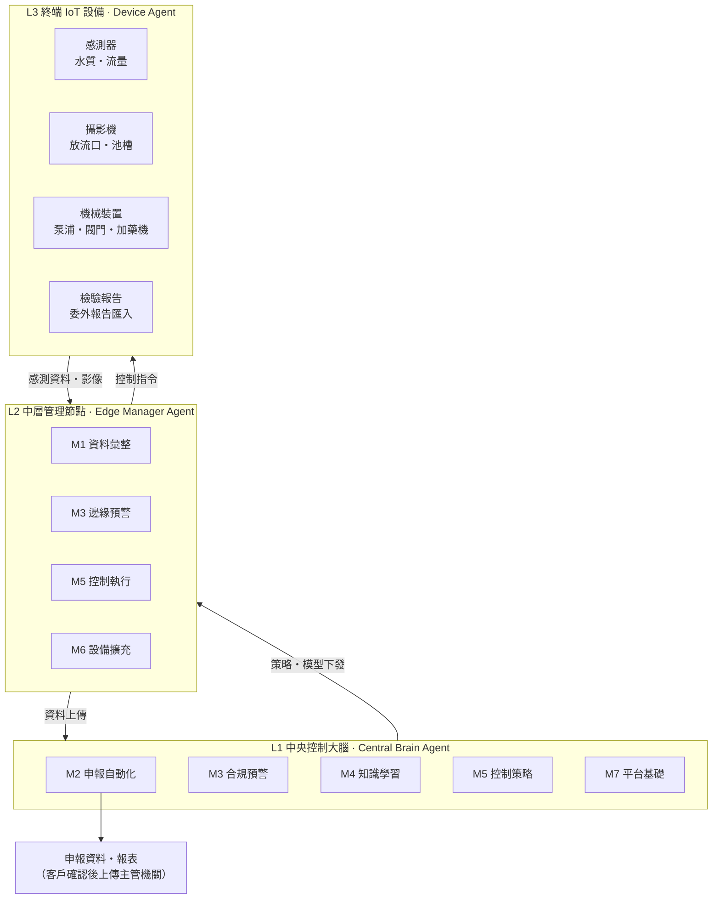

# WUCA — Water Unified Control Agents

**水務統一控制智能代理平台**：以 AI 與 IoT 感測技術打造的污水智能管理平台。

第一期聚焦半導體廠的**水污染防治費（水污費）自動化申報**，平台會：

- 定期自動收集各項計費指標
- 自動整理申報所需資料
- 從每日數據累積該廠的水質管理知識，再應用到自動化管理

## 系統架構

WUCA 採三層多代理（multi-agent）架構：資料由終端往上匯集，申報與學習在中央進行，控制指令再往下執行。



| 層級 | 角色 | 職責 |
| --- | --- | --- |
| L1 中央控制大腦 | Central Brain Agent | 申報計算、全域決策、AI 模型訓練與下發、跨區調度 |
| L2 中層管理節點 | Edge Manager Agent | 管理轄區設備、資料彙整與品質檢核、邊緣推論、斷線時自主運作 |
| L3 終端 IoT 設備 | Device Agent | 感測器、攝影機、機械裝置的資料回報與指令執行 |

## 功能模組

M1、M2、M7 構成申報的最小可行組合，其餘模組可以逐步加購。

| 模組 | 主要功能 | 層級 | 導入方式 |
| --- | --- | --- | --- |
| M1 資料收集與設備接入 | 線上感測（pH、COD、濁度/SS、氨氮、氟離子、導電度、流量）；放流口與池槽影像；泵浦、閥門、加藥機狀態；委外檢驗報告匯入（PDF/OCR）；資料品質檢核 | L3 → L2 | 必備 |
| M2 水污費申報自動化 | 計費項目與費率參數庫（依法規版本切換）；實測值/係數雙模式計算；申報報表自動產出；期程提醒；稽核軌跡 | L1 | 必備 |
| M3 合規監控與預警 | 對照放流水標準與許可限值；超標預警；水污費月度試算與減量優惠級距模擬 | L1、L2 | 可加購 |
| M4 水質知識學習 | 每日數據彙整；廠區知識庫（製程事件與水質變化的關聯）；濃度預測與異常偵測；自然語言問答 | L1 | 可加購 |
| M5 自動化管理與控制 | 建議 → 核准後執行 → 全自動 三級；加藥量最佳化、泵浦調度；安全連鎖與手動接管 | L1 / L2 | 可加購（需 M4） |
| M6 設備擴充框架 | 設備註冊與 Device Profile；MQTT、Modbus、OPC UA；新終端開發 SDK；韌體更新 | L2、L3 | 平台內建 |
| M7 平台基礎 | 儀表板、帳號權限、通知、資安（OT/IT 區隔）、資料保存與備份 | L1 | 必備 |

## 法規依據

法源為《事業及污水下水道系統水污染防治費收費辦法》，環境部 2025-03-31 修正。

- **新增計費項目**：2026 年（民國 115 年）起新增氨氮、鋅、錫。
- **費率調整**：多項重金屬費率逐年調升到 2031 年（民國 120 年）。
- **費額計算**：

  ```
  費額 = Σ(費率ᵢ × 排放濃度ᵢ) × 排放水量
  ```

- **減量優惠**：依「排放濃度 ÷ 放流水標準最大限值」的級距打折，低於 10% 免繳，但仍須申報。
- **申報期程**：每半年一期，每年 1 月底、7 月底前經[水污費網路申報系統](https://wpcf.moenv.gov.tw)申報繳納。

| 計費項目 | 費率（元/公斤，115 → 120 年） |
| --- | --- |
| 化學需氧量（COD） | 12.5 |
| 懸浮固體（SS） | 0.62 |
| 氨氮（新增） | 40 → 80 |
| 鉛、鎳、銅 | 1,000 → 2,000 |
| 鋅、錫（新增） | 1,000 → 2,000 |
| 總鉻、砷 | 2,000 → 4,000 |
| 鎘、氰化物 | 10,000 → 20,000 |
| 總汞 | 50,000 → 100,000 |

> 費率在平台中一律做成可依年度切換的參數，以[環境部公告](https://water.moenv.gov.tw/Public/CHT/wsr_1/WW_Control/WPCF.aspx)為準。

## 導入路徑

1. **第一期　申報自動化**（M1 + M2 + M7）：自動產出水污費申報資料，以一個申報期與人工申報結果比對驗收。
2. **第二期　合規預警**（+ M3）：超標預警、月度試算、減量優惠模擬。
3. **第三期　知識學習**（+ M4）：濃度預測、異常偵測、廠區知識庫。
4. **第四期　自動化控制**（+ M5）：從「只給建議」開始，依準確度逐步開放自動執行。

M6 設備擴充框架貫穿各期，任何一期都可以接入新的終端設備。

## 待確認事項

- [ ] 法定檢測頻率；氨氮、鋅、錫的分年費率是否另有折扣
- [ ] 目標廠是自有放流口，還是排入科學園區污水下水道
- [ ] 申報要與環境部系統直接介接，還是產出檔案即可
- [ ] 客戶現有線上監測設備、SCADA 與通訊協定清單
- [ ] 部署方式：廠內地端、私有雲或混合
- [ ] M5 自動控制可以操作哪些設備，由誰核准

---

© CAFECA
