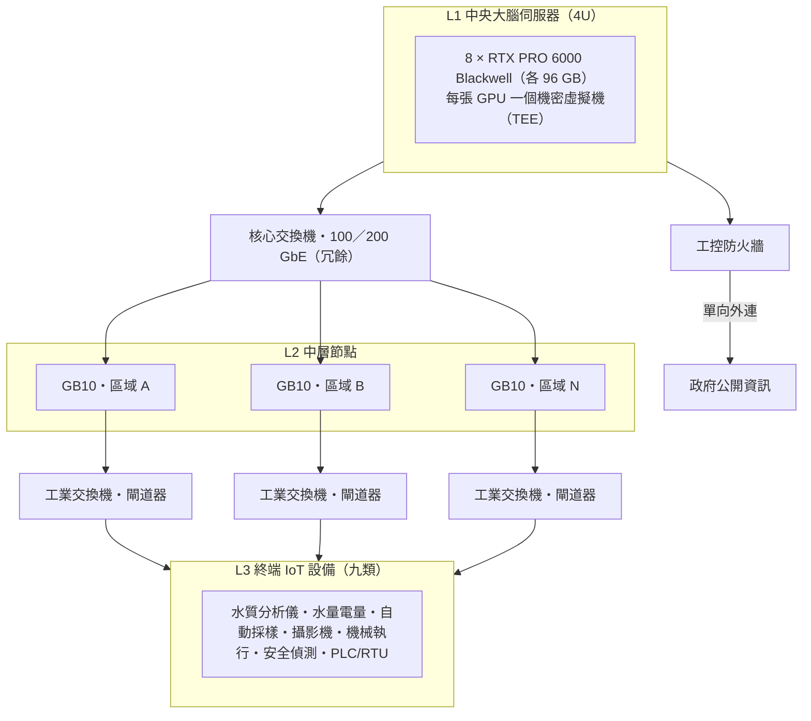

# WUCA 硬體清單

> 更新日期：2026-10-11　｜　線上版：[WUCA 硬體清單](https://claude.ai/code/artifact/b7b541ce-0593-421d-9188-2ffb5b7958d5)

## 硬體架構

WUCA 的硬體分三層，全部廠內地端部署：

- **中央大腦**：一台 8 卡 RTX PRO 6000 Blackwell 伺服器。
- **中層節點**：每個處理區域一台 NVIDIA GB10。
- **終端設備**：現場設備經工業閘道器接入。

| 層級 | 硬體 | 數量 |
| --- | --- | --- |
| L1 中央大腦 | 4U 伺服器，8 × RTX PRO 6000 Blackwell Server Edition，支援 TEE | 每廠 1 台 |
| L2 中層節點 | NVIDIA GB10 主機＋工業交換機、閘道器、UPS | 每個處理區域 1–2 台 |
| L3 終端設備 | 九類市售 IoT 設備 | 依廠區盤點 |

## 中央大腦：8 卡 RTX PRO 6000 Blackwell 伺服器

中央大腦採 4U 機架式伺服器，搭 8 張 RTX PRO 6000 Blackwell Server Edition，合計 768 GB 顯存。這張卡支援機密運算（TEE），但目前只能**一張卡對一個機密虛擬機**，這會影響 AI 模型的部署方式。

### GPU 規格

| 項目 | RTX PRO 6000 Blackwell Server Edition（單卡） |
| --- | --- |
| 顯存 | 96 GB GDDR7 ECC，頻寬約 1.6 TB/s |
| AI 算力 | FP4 峰值 4 PFLOPS，752 個第五代 Tensor Core |
| 功耗與散熱 | 最高 600 W（可調），被動散熱，靠伺服器風扇 |
| 介面 | PCIe 5.0 x16，雙槽全高 |
| 分割 | MIG 最多 4 個 24 GB 實例 |
| 影像 | 4 組 NVENC、4 組 NVDEC、4 組 JPEG 引擎（攝影機串流解碼） |
| 安全 | 機密運算、Secure Boot、硬體信任根 |

### 整機建議配置

| 元件 | 建議規格 | 理由 |
| --- | --- | --- |
| GPU | 8 × RTX PRO 6000 Blackwell Server Edition | 指定規格 |
| CPU | 2 × Intel Xeon 6（TDX）或 2 × AMD EPYC 9005（SEV-SNP） | GPU 機密運算需要 CPU 端 TEE；Intel 需第 5 代以上、AMD 需 Genoa 以上 |
| 記憶體 | ≥ 1.5 TB DDR5 ECC | 約為 GPU 顯存 2 倍，供模型載入與向量資料庫；依 TDX 規則平均插滿通道 |
| 開機碟 | 2 × M.2 NVMe，RAID 1 | 系統冗餘 |
| 資料碟 | 8 × NVMe（E3.S 或 U.2），自加密（SED） | 水質時序、影像、稽核紀錄長期保存 |
| 網路 | 2 × 100/200 GbE（對中層節點）＋獨立 BMC 管理埠 | 影像與模型下發頻寬 |
| 電源 | 冗餘熱插拔 3,200 W Titanium | 8 張 GPU 就達 4.8 kW，整機需依廠商電源計算 |
| 安全 | TPM 2.0、矽信任根、Secure Boot、簽章韌體 | 地端部署的完整性保護 |

### TEE 部署限制

- **一張 GPU 對一個機密虛擬機**：此卡目前只通過單 GPU 機密模式（SPT CC），沒有 NVLink，多 GPU 機密模式尚未驗證。整台機最多開 8 個機密虛擬機，各自 96 GB。
- **模型需放得進單卡**：在 TEE 內執行的 AI 廠長、法規解析等模型，量化後需小於 96 GB。超過的模型只能在非 TEE 模式跨卡執行，或等 NVIDIA 驗證多卡機密模式。
- **驅動版本**：R580 起支援此卡機密模式，目前正式版為 R595；韌體、VBIOS 要對照 NVIDIA 的相容性矩陣。
- **優先直連拓樸**：帶橋接的 PCIe 交換拓樸曾導致證明（attestation）失敗；採購前請廠商以機密模式實機驗證。

建議的 8 卡分配（設計建議）：

| GPU | 用途 | 模式 |
| --- | --- | --- |
| 0–1 | AI 廠長代理（主／備） | TEE |
| 2 | 法規解析與申報檔產生 | TEE |
| 3–4 | 水質預測與異常偵測（M4） | TEE |
| 5 | 影像分析（放流口、池槽） | TEE 或 MIG |
| 6–7 | 模型訓練與微調 | 依資料敏感度 |

### 可選機型

| 機型 | 尺寸 | CPU 平台 | 備註 |
| --- | --- | --- | --- |
| [Dell PowerEdge XE7745](https://www.delltechnologies.com/asset/fr-fr/products/servers/technical-support/poweredge-xe7745-spec-sheet.pdf) | 4U | 2 × AMD EPYC 9005，最高 384 核 | 8 張 600 W 雙槽 GPU；24 DIMM、最高 6 TB；8 × E3.S；3,200 W Titanium |
| [Supermicro SYS-422GA-NRT](https://www.supermicro.com/datasheet/datasheet_Supermicro_RTX_PRO_BSE.pdf) | 4U | 2 × Intel Xeon 6900 | 最多 8 張 RTX PRO 6000 |
| [Supermicro AS-4125GS-TNRT2](https://www.supermicro.com/datasheet/datasheet_Supermicro_RTX_PRO_BSE.pdf) | 4U | AMD EPYC | 最多 8 張 RTX PRO 6000 |
| [Supermicro SYS-422GL-FNR2](https://www.supermicro.com/datasheet/datasheet_Supermicro_RTX_PRO_BSE.pdf) | 4U | Intel Xeon 6 | ConnectX-8 PCIe 交換板；需先驗證 TEE 證明流程 |

NVIDIA 公告的其他 RTX PRO 伺服器夥伴含 Cisco、HPE、Lenovo、ASUS、GIGABYTE、MSI、QCT、Wiwynn、研華等，8 卡配置為 4U。Supermicro 型錄欄位在轉檔時有錯位，下單前請對照官方規格書。

## 中層管理節點：NVIDIA GB10

每個處理區域放一台 GB10 主機，負責邊緣推論與設備管理。GB10 機型都是約 15 公分見方的桌上型機殼，沒有 RS-485 等工業介面，現場要搭配工業閘道器和控制箱。

### GB10 共通規格

| 項目 | 規格 |
| --- | --- |
| CPU | 20 核 Arm（10 × Cortex-X925 ＋ 10 × Cortex-A725） |
| GPU | Blackwell，第五代 Tensor Core，最高 1 PFLOP FP4（稀疏） |
| 記憶體 | 128 GB LPDDR5X 統一記憶體，273 GB/s |
| 網路 | 10 GbE ＋ ConnectX-7（雙 QSFP，200 Gbps） |
| 儲存 | 1–4 TB NVMe |
| 電源／尺寸 | 240 W 外接電源；約 150 × 150 × 51 mm、1.2 kg |
| 軟體 | NVIDIA DGX OS（以 Ubuntu 為基底） |
| 可跑模型 | 單機約 200B 參數，兩機串接約 405B |

### 可選機型

| 機型 | 儲存 | 特點 |
| --- | --- | --- |
| [Lenovo ThinkStation PGX](https://aicybr.com/blog/gb10-ai-workstations-dgx-spark-dell-asus-hp-lenovo) | 1／4 TB 自加密 NVMe | TPM 2.0、Secure Boot、硬碟不退回服務；**推薦**，安全功能最齊 |
| [Dell Pro Max with GB10](https://aicybr.com/blog/gb10-ai-workstations-dgx-spark-dell-asus-hp-lenovo) | 1／2／4 TB，現場可換 | 雙 200G QSFP；Dell 保固 |
| [ASUS Ascent GX10](https://aicybr.com/blog/gb10-ai-workstations-dgx-spark-dell-asus-hp-lenovo) | 1／2 TB PCIe 4.0、4 TB PCIe 5.0 | 儲存選項最多 |
| [HP ZGX Nano G1n](https://aicybr.com/blog/gb10-ai-workstations-dgx-spark-dell-asus-hp-lenovo) | 1／2／4 TB | ZGX Toolkit |
| [MSI EdgeXpert MS-C931](https://www.starryhope.com/minipcs/models/msi-edgexpert-ms-c931/) | 1／4 TB | 10GbE ＋ 雙 QSFP |
| [NVIDIA DGX Spark](https://aicybr.com/blog/gb10-ai-workstations-dgx-spark-dell-asus-hp-lenovo) | 1／4 TB | 參考機，韌體更新最早；官方售價 US$4,699 |

### 安全與現場限制

- **GB10 沒有 TEE**：Grace 系 Arm CPU 不支援機密運算，中層節點改用 TPM 2.0、Secure Boot、自加密硬碟保護。機密性高的運算放在中央大腦的 TEE 內。
- **非工業級機殼**：未標示寬溫、防塵或 DIN 軌安裝，需放在空調控制室或帶散熱的控制箱內。
- **沒有工業介面**：只有 USB-C、乙太網路與 QSFP，現場設備要經工業閘道器接入。

### 每個中層節點的配件

| 配件 | 數量 | 用途 |
| --- | --- | --- |
| GB10 主機 | 1（關鍵區域 2 台互備） | 邊緣推論、設備管理、斷線自主運作 |
| 工業 IoT 閘道器 | 依設備數 | RS-485／Modbus RTU 轉 MQTT／OPC UA，寬溫、DIN 軌 |
| 工業管理型交換機 | 1 | 連接閘道器、PLC、攝影機；支援 VLAN、PoE |
| 在線式 UPS | 1 | 斷電時保持資料記錄與安全關機 |
| 控制箱／機櫃 | 1 | 防塵、散熱、上鎖 |

## 終端 IoT 設備

終端設備分九類。大多數市售產品都有 4–20 mA 或 Modbus，可直接經工業閘道器接入中層節點。標「※」者為業界常見產品，未逐一查證型錄。

### 1. 水質線上分析儀（對應計費項目）

| 量測項目 | 市售產品 | 介面 |
| --- | --- | --- |
| COD | [HORIBA CODA-500](https://static.horiba.com/fileadmin/Horiba/Products/Process_and_Environmental/Water_Pollution/Brochures/CODA-500/Brochure-Automatic_COD_Monitor_CODA-500.pdf)、[E+H Liquiline CA80COD](https://bdih-download.endress.com/file/005056A5E3831EDBB8DDE86D9BB2113F/IN01084CEN_CA80COD_lowres.pdf) | 4–20 mA、RS-485 Modbus；E+H 另有 PROFIBUS DP、EtherNet/IP |
| TOC（可換算 COD） | [Shimadzu TOC-4200](https://shimadzu.com/an/toc/online/toc-4200.html) | RS-485；最多 6 路水流切換 |
| 氨氮 | KRK、Hach Amtax※、E+H CA80AM※ | 4–20 mA、Modbus |
| 重金屬（銅、鎳、鋅等單項） | [Hach EZ1000／EZ2000 系列](https://cdn.hach.com/7FYZVWYB/at/hgmxpgvg8z8jm69t4c3w3w3/DOC0535335169Oct22-EZ1000-Zn.pdf) | 4–20 mA（最多 8 路）、Modbus RS-485／TCP |
| 重金屬（多項：鉛、鎘、砷、六價鉻等） | [Metrohm 2060 VA](https://metrohm.com/content/dam/metrohm/shared/documents/brochures/8000/80005490EN.pdf) | 依型錄確認 |
| 鋅現場快篩 | [Lovibond 比色計](https://www.nizawa-int.com.tw/article_d.php?lang=tw&tb=4&id=1384) | 手入／檔案匯入 |
| SS／濁度 | Hach Solitax※、E+H Turbimax※ | 4–20 mA、Modbus |
| 氟離子 | 離子選擇電極分析儀（Hach※、Metrohm※） | 4–20 mA、Modbus |
| MLSS／污泥濃度、污泥界面 | Hach※、E+H※ | 4–20 mA、Modbus（M8 好氧孿生） |
| pH、ORP、導電度、DO | [Yokogawa FLXA21／EXA](https://yokogawa.com/tw/industries/water-wastewater)、E+H Liquiline※、Hach SC 控制器※ | 4–20 mA／HART、Modbus、PROFIBUS |

### 2. 水量與電量

| 設備 | 市售產品 | 介面 |
| --- | --- | --- |
| 電磁流量計（滿管） | Yokogawa、E+H Promag※、KROHNE※、Siemens※ | 4–20 mA／HART、脈衝、Modbus |
| 明渠／非滿管流量計 | 超音波或雷達式（VEGA※、E+H※） | 4–20 mA、Modbus |
| 液位計 | 雷達式（VEGAPULS※、E+H Micropilot※） | 4–20 mA／HART |
| 電子式電度表 | 多功能電力表（Schneider※、台達電※） | Modbus RTU／TCP |

《水污染防治措施及檢測申報管理辦法》第 56 條在特定情形下要求設置電子式電度表，用於佐證處理設施確實運轉。

### 3. 自動採樣

| 設備 | 市售產品 | WUCA 用途 |
| --- | --- | --- |
| 冷藏式自動採樣器 | Hach AS950※、Teledyne ISCO※ | 異常時由 AI 觸發留樣，作為實驗室複驗與稽核證據 |

### 4. 影像

| 設備 | 市售產品 | WUCA 用途 |
| --- | --- | --- |
| 固定式 IP 攝影機 | Axis※、VIVOTEK※、Hikvision※（ONVIF、RTSP） | 放流口顏色、泡沫、水位辨識 |
| 熱像攝影機 | Axis※、FLIR※ | 馬達、配電盤過熱 |
| PTZ 攝影機 | 同上※ | 池槽巡檢、事件追蹤 |

### 5. 機械執行裝置（AI 廠長操作對象）

| 設備 | 市售產品 | 介面 |
| --- | --- | --- |
| 加藥泵 | [Grundfos DDA](https://www.grundfos.com/content/dam/global/activity-assets/isolutions-industry/documents-and-cases/brochures/dda/4014481_DDA_brochure_US_v1.pdf)、ProMinent※ | DDA 內建 Modbus RTU／TCP；PROFIBUS、PROFINET、EtherNet/IP 需加模組 |
| 泵浦＋變頻器 | Grundfos※、ABB※、Danfoss※、台達電※ | Modbus、PROFINET、EtherNet/IP |
| 電動閥／閘門致動器 | AUMA※、Rotork※ | 4–20 mA、Modbus、PROFIBUS |
| 曝氣鼓風機 | 磁懸浮／空氣軸承鼓風機※ | Modbus、乙太網路 |
| 攪拌機、刮泥機 | 經 PLC 控制 | 乾接點／PLC |

### 6. 安全與環境監測

| 設備 | 市售產品 | WUCA 用途 |
| --- | --- | --- |
| 氣體偵測器（H₂S、NH₃、Cl₂） | Dräger※、Honeywell※ | L3 緊急事件觸發 |
| 漏液偵測 | 感測線纜式※ | 藥劑槽、管線洩漏 |
| 溫濕度與電力品質 | 各品牌※ | 控制箱與機房環境 |

### 7. 現場控制與閘道器

| 設備 | 市售產品 | 重點 |
| --- | --- | --- |
| 工業 IoT 閘道器 | [Advantech ADAM-6717、Siemens SIMATIC IOT2050、Moxa MGate 5105-MB-EIP、Robustel R3000、Elastel EG324](https://ubidots.com/blog/top-industrial-iot-gateways/) | Modbus RTU／TCP 轉 MQTT／OPC UA；ADAM-6717 與 R3000 寬溫 −40 °C 起 |
| PLC／RTU | [Allen-Bradley、Modicon](https://industrialmonitordirect.com/blogs/knowledgebase/scada-system-selection-guide-for-water-wastewater-plants)、Siemens S7※、Mitsubishi※、Yokogawa STARDOM | 通常已存在，平台先以只讀介接 |

### 8. 設備健康（M10）

| 設備 | 市售產品 | WUCA 用途 |
| --- | --- | --- |
| 無線振動／溫度感測器 | 各品牌※（ISA100、藍牙或 4–20 mA） | 泵浦、鼓風機、攪拌機軸承異常與預知保養 |
| 馬達電流／電力監測 | 多功能電力表※ | 負載異常、能耗統計（M9） |

### 9. 進流與管網（M11，下水道系統廠型）

| 設備 | 市售產品 | WUCA 用途 |
| --- | --- | --- |
| 人孔液位／流量計 | 雷達或超音波式（VEGA※、E+H※），電池供電加 NB-IoT／LoRa 傳輸 | 管網水量、溢流與不明水分析 |
| 管網水質探頭 | pH、導電度、溫度多參數探頭※ | 異常排入預警與上游溯源 |
| 管道 CCTV 檢視機器人 | 管道檢視車※ | 管段障礙、斷漏紀錄與汰換依據 |

### 自動收集與數據頻率

水污費 13 個計費項目（及檢測申報項目六價鉻）市面上都有線上分析儀可自動收集，但週期從 1 分鐘到 75 分鐘不等。仍無法自動收集的只有四類：法定委外檢驗報告、自動採樣後的實驗室結果、現場快篩、管道 CCTV 檢視。

| 設備 | 自動收集 | 多久一筆 | 依據 |
| --- | --- | --- | --- |
| pH、ORP、導電度、DO、溫度探頭 | 是 | 連續輸出，平台每 1–60 秒取樣 | ※電極式即時量測 |
| 濁度／SS、MLSS、污泥界面 | 是 | 每 1–60 秒 | ※光學式即時量測 |
| 流量計、液位計 | 是 | 每 1 秒起；累計量每 1–15 分鐘結算 | ※ |
| 電子式電度表、電力表 | 是 | 每 1 秒至 1 分鐘 | ※ |
| COD（HORIBA CODA-500） | 是 | 每 60 分鐘 | [型錄](https://static.horiba.com/fileadmin/Horiba/Products/Process_and_Environmental/Water_Pollution/Brochures/CODA-500/Brochure-Automatic_COD_Monitor_CODA-500.pdf) |
| TOC（Shimadzu TOC-4200） | 是 | 最快每 4 分鐘 | [型錄](https://shimadzu.com/an/toc/online/toc-4200.html) |
| 氨氮（Hach Amtax sc） | 是 | 最快每 5 分鐘（可設定間隔） | [型錄](https://www.hach.com/p-amtax-sc-ammonia-analyzers/6158000) |
| 鋅、銅、鎳（Hach EZ1000／EZ2000） | 是 | 鋅每 10 分鐘（含稀釋） | [型錄](https://cdn.hach.com/7FYZVWYB/at/hgmxpgvg8z8jm69t4c3w3w3/DOC0535335169Oct22-EZ1000-Zn.pdf) |
| 錫（Kacise KTT600） | 是 | 約每 30 分鐘；量程 0–5 mg/L、檢出限 0.1 mg/L | [型錄](https://www.kcsensor.com/product/online-total-tin-analyzer-ktt600/) |
| 六價鉻（Hach HMA-Cr6）、總鉻（HMA-TCR） | 是 | 週期未公開；Cr6 量程 0.04–5 mg/L、RS-485 Modbus-RTU | [哈希中國](https://www.hach.com.cn/product/hmajinshu/technical) |
| 砷（Hach EZ6000） | 是 | 週期未公開 | [哈希中國](https://www.hach.com.cn/product/hmajinshu) |
| 鉛、鎘等多項重金屬（Metrohm 2060 VA） | 是 | 數十分鐘級※，官方未公開 | [型錄](https://metrohm.com/content/dam/metrohm/shared/documents/brochures/8000/80005490EN.pdf) |
| 汞（Envea PA-2） | 是 | 反應時間約 1 分鐘 | [型錄](https://envea.global/s/ambient/mercury-monitors-a/pa-2-pa2-gold) |
| 總氰化物（Hach EZ2000） | 是 | 每 75 分鐘（含稀釋） | [型錄](https://cdn.hach.com/7FYZVWYB/at/4qgb2sqkqkt6bv7mbg67r78z/DOC0535335172Oct22-EZ2000-Cn-tot.pdf) |
| 氟離子分析儀 | 是 | 約每 5–15 分鐘※ | ※ |
| 泵浦、閥門、加藥泵狀態 | 是 | 每 1 秒（經 PLC） | ※ |
| 氣體、漏液偵測 | 是 | 連續，警報即時事件 | ※ |
| 振動／溫度感測器 | 是 | 高頻取樣，每 1–10 分鐘彙整一筆特徵值 | ※ |
| 人孔液位／流量計（電池供電） | 是 | 每 5–15 分鐘（為省電） | ※ |
| 攝影機 | 是 | 15–30 fps 串流；AI 辨識以事件為筆 | ※ |
| 自動採樣器 | 半自動 | 事件觸發留樣；數據依實驗室結果 | 樣品需人工送驗 |
| 法定委外檢驗報告 | 否 | 依法定頻率每 3–12 個月 | 需由認可實驗室採樣分析；PDF／Excel OCR 匯入 |
| 鋅現場快篩（Lovibond） | 否 | 依巡檢排程 | 手入或藍牙傳輸※ |
| 管道 CCTV 機器人 | 否 | 依檢視工程排程 | 影片匯入 |

注意：線上分析儀的檢出限要低於「放流水標準 × 10%」，否則無法佐證減量優惠的免繳級距；各儀器量程需對照該廠適用的標準選型。

**資料量檢核**：以單廠 150 個點位、每分鐘一筆計，每日約 21.6 萬筆，符合「每日至少 20 萬筆」的非功能需求。

## 網路與基礎設施

廠內地端部署需要獨立的 OT 網段，並只開一條單向外連，讓中控大腦抓取法規公開資訊。以下為設計建議，品牌依客戶既有標準。

| 設備 | 建議規格 | 用途 |
| --- | --- | --- |
| 核心交換機 | 100／200 GbE，冗餘一對 | 中央大腦與各 GB10 互連（影像、模型下發） |
| 現場工業交換機 | 管理型、VLAN、PoE、寬溫、DIN 軌 | 閘道器、PLC、攝影機接入 |
| 工控防火牆 | 支援 Modbus／OPC UA 深度檢測 | OT／IT 區隔；只允許對政府網站的單向外連 |
| 時間同步 | PTP（IEEE 1588）或 GPS 校時 NTP 伺服器 | 水質、水量、影像時間戳一致，稽核必要 |
| 中央機房 UPS | 在線式，容量依伺服器實際功耗計算 | 8 卡伺服器滿載可達數 kW |
| 中央機櫃與空調 | 支援 4U 深機（Dell XE7745 深約 90 cm） | GPU 伺服器散熱 |
| 備份儲存 | NAS 或磁帶，異地或離線保存 | 申報證據與稽核紀錄長期保存 |

費用估算見 [單廠建置費用試算](cost-estimate.md)。

## 來源

- [NVIDIA RTX PRO 6000 Blackwell Server Edition 規格書](https://www.akamai.com/site/en/documents/corporate/nvidia-rtx-pro-6000-blackwell-server-edition-datasheet.pdf)
- [NVIDIA：RTX PRO 伺服器夥伴公告（2025-08-11）](https://investor.nvidia.com/news/press-release-details/2025/NVIDIA-RTX-PRO-Servers-With-Blackwell-Coming-to-Worlds-Most-Popular-Enterprise-Systems/)
- [Super Protocol：GPU／CPU TEE 需求整理（2026-05-22）](https://superprotocol.com/resources/gpu-cpu-tee-requirements)
- [Dell PowerEdge XE7745 規格書](https://www.delltechnologies.com/asset/fr-fr/products/servers/technical-support/poweredge-xe7745-spec-sheet.pdf)
- [Supermicro RTX PRO 系統型錄](https://www.supermicro.com/datasheet/datasheet_Supermicro_RTX_PRO_BSE.pdf)
- [GB10 機型比較（aicybr）](https://aicybr.com/blog/gb10-ai-workstations-dgx-spark-dell-asus-hp-lenovo)
- [MSI EdgeXpert MS-C931 規格](https://www.starryhope.com/minipcs/models/msi-edgexpert-ms-c931/)
- [工業 IoT 閘道器比較（Ubidots）](https://ubidots.com/blog/top-industrial-iot-gateways/)
- 各儀器型錄已附在「終端 IoT 設備」表格內
