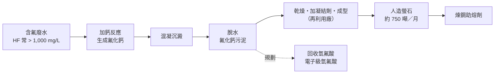

# WUCA 協助廢水資源化與經濟效益

> 更新日期：2026-10-14　｜　依據：[不同場域污水處理關注事項](https://claude.ai/code/artifact/a3e0155a-a64c-48d8-b196-ee5f44d10fea)

法規正從「去除污染」轉向「能資源化」：2024 年放流水標準加嚴氨氮、總磷、銅，2026 年起水污費新增氨氮、鋅、錫並逐年調升；投資能資源化設施並操作 3 年以上，可申請水污費抵減（各期上限 60%，最多 3 年）。WUCA 協助廠方把「處理成本」變成「可回收收入」，同時降低水污費。

## 各場域可回收資源

| 場域 | 可回收資源 | 產品與用途 | 公開數據 |
| --- | --- | --- | --- |
| 晶圓及半導體 | 含氟廢水 → 氟化鈣污泥 | 人造螢石，煉鋼助熔劑 | 1,500 噸污泥／月產出約 750 噸螢石；成本約天然螢石 1/3 |
| 晶圓及半導體 | CMP 研磨廢水 → 氧化矽污泥 | 礦石粉（塑膠、陶瓷填料）、硫酸銅 | 800 噸／月產出礦石粉 480 噸 |
| 晶圓及半導體 | 廢異丙醇 | 精製為電子級，回到製程 | 2,300 噸／月再生 300 噸 |
| 晶圓及半導體 | 廢混合有機溶劑 | 熱回收產蒸氣 | 1,300 噸／月，每小時 15 噸蒸氣 |
| 晶圓及半導體 | 含氨廢水（6–25%） | 工業級液氨，規劃電子級 | 純度 > 99.85%、回收率 > 95% |
| 晶圓及半導體 | 含銅電鍍廢液、機台廢水 | 銅離子回收、硫酸銨、顯影液、水回收 | 銅降至 0.01 mg/L 以下；廢水回收率約 87.4% |
| 光電 | 顯影液、溶劑 | 回收再用 | ※依廠評估 |
| 印刷電路板 | 蝕刻液、化學鎳廢液 | 銅、鎳金屬 | 鎳回收為學術研究階段 |
| 金屬表面處理、電鍍 | 含重金屬廢液 | 金屬回收 | ※依廠評估 |
| 公共污水、食品、畜牧 | 污泥、高濃度有機廢水 | 沼氣發電、再生水 | 龜山水資源回收中心 800 kW、每年約 640 萬度 |

## 案例：含氟廢水轉人造螢石

- 純度：氟化鈣最高約 80%，硬度與形狀依鋼廠規格調整。
- 經濟性：成本約天然螢石三分之一；中國自 2010 年限制螢石出口後，進口價格上漲。
- 許可：需經產業發展署與環境部再利用審查，業者約花三年以上。
- 規模：台積電中科零廢中心滿載時每年可減少約 13 萬公噸委外處理廢棄物（中科廠區 85% 以上），效益逾 NT$12 億。

## WUCA 在資源化中做什麼

| 環節 | WUCA 的做法 | 模組 |
| --- | --- | --- |
| 前端分流監測 | 含氟、含氨、研磨、含銅各支流分別設監測點，確保進入回收的廢液水質單純穩定 | M1、M11 |
| 回收品質最佳化 | AI 廠長調整鈣鹽加藥與 pH，兼顧放流氟鹽達標與氟化鈣純度、含水率 | M5、M8 |
| 資源化追蹤 | 記錄污泥、廢溶劑、回收液的產量、品質與交付再利用廠紀錄 | 建議新增 M12 |
| 水污費降費 | 模擬減量優惠級距，找出把濃度壓到放流水標準 10% 以下的操作條件 | M2、M8 |
| 水污費抵減申請 | 產出能資源化設施操作期間、效益評估與成效資料 | M2、M12 |
| 法規追蹤 | 追蹤再利用、放流水標準與費率變動，提前試算影響 | M2 |
| 效益儀表板 | 呈現回收收入、委外處理費節省、水污費節省、節能節藥 | M7、M9 |

## 經濟效益來源

| 效益 | 公開案例或試算 |
| --- | --- |
| 回收產品收入、委外處理費下降 | 台積電中科零廢中心效益逾 NT$12 億／年 |
| 藥劑節省 | 國內晶圓代工廠導入 AI 加藥控制，氯化鈣用量降 8–12%，單廠年省近千萬 |
| 水回收 | 12 吋廠改單片清洗後一滴水用 3.5 次，一年省約 7.5 億元 |
| 能源 | 污泥沼氣發電，每年約 640 萬度 |
| 水污費 | 見下方試算 |
| 水污費抵減 | 能資源化設施各期抵減上限 60%，最多 3 年 |

### 試算：氨氮降至減量優惠免繳級距

假設某廠放流水量每日 5,000 立方公尺，氨氮 20 mg/L，適用標準 30 mg/L（排放濃度約為標準 67%，費額 × 80%）。

| 年度 | 氨氮費率（元/公斤） | 現況年費額 | 降至 3 mg/L 以下（< 10%，免繳） | 每年節省 |
| --- | --- | --- | --- | --- |
| 2026 | 40 | 約 117 萬 | 0 | 約 117 萬 |
| 2031 | 80 | 約 234 萬 | 0 | 約 234 萬 |

計算：5,000 m³/日 × 20 mg/L × 365 日 = 36,500 公斤／年；× 費率 × 80%。此為示意，實際以廠方適用標準、排放數據與環境部公告為準；回收的氨若製成液氨，另有產品收入。

## 來源

- [116 年放流水標準大改版](https://eith.com.tw/2027effluent-standards/)
- [環境部修正發布「放流水標準」（CSRone）](https://csrone.com/news/9025)
- [事業及污水下水道系統水污染防治費收費辦法](https://www.rootlaw.com.tw/LawArticle.aspx?LawID=A040300050004100-1140331)
- [立盈環保人造螢石（數位時代）](https://www.bnext.com.tw/article/82286/lept-artificial-fluorite)
- [台積電零廢中心（知新聞）](https://www.knews.com.tw/news/0F2B0E4B158FBCAE2FC60FF8ED834665)
- [氨回收再生液氨系統（經濟日報）](https://money.udn.com/money/story/5735/8995453)
- [半導體廢水處理（SEMI）](https://www.semi.org/zh/blogs/technology-trends/semiconductor/green-manufacturing/water-disposal)
- [半導體廢水 AI 加藥案例（科勝科技）](https://contents.utitech.com.tw/utitech_blog/success-story-taiwan-semiconductor-ai-wastewater-chemical-dosing-system)
- [龜山水資源回收中心沼氣發電（ETtoday）](https://finance.ettoday.net/news/3050861)
- [PCB 化學鎳廢液回收鎳（陽明交大）](https://ir.lib.nycu.edu.tw/handle/11536/37897)
